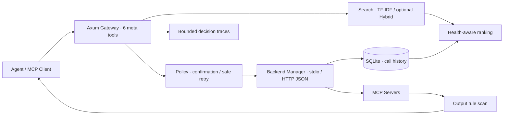

# MCP Sentinel

**面向 AI Agent 的 Rust MCP 网关：按需发现工具、健康感知路由、副作用治理与决策追踪。**

[](https://github.com/fan-123kf/mcp-sentinel/actions/workflows/ci.yml)
[](LICENSE)

Agent 接入多个 MCP server 后，工具定义占用上下文，而“相关的工具”未必是“当前可用的工具”。MCP Sentinel 在客户端与后端之间增加网关：客户端只加载 **6 个稳定元工具**，检索时按需获取具体工具的 schema，再由统一入口执行调用。

这是一个可本地运行的工程原型，探索 **工具检索、可靠性信号和调用治理如何协同工作**。默认无需模型、API key 或外部服务即可运行测试和离线评测。

## 项目亮点

- **按需发现**：返回 `server::tool`、参数 schema 和排名信息，减少初始工具列表占用。
- **健康参与排序**：调用结果、延迟、连续失败和使用历史进入路由决策；新工具不会因缺少历史被直接淘汰。
- **谨慎执行**：Read / Write / Destructive 分级；写入与删除需要显式确认，自动重试限定为只读工具的暂时性错误。
- **可解释决策**：`VecDeque` 保存最近 200 条搜索和调用 trace，拒绝与输出拦截也返回 `trace_id`。
- **分层规则扫描**：检查工具描述、参数 schema 和完整返回值（含 `structuredContent`），隔离可疑元数据、阻断可疑输出。
- **可复现评测**：固定语料、逐查询排名、实际执行策略和明确的 token 统计范围。

## 架构与执行链



搜索链路：元数据扫描 → 索引 → 相关性召回 → 服务过滤 → 可选重排 → 健康惩罚 → 返回 schema。

调用链路：查找工具 → 元数据复查 → 副作用策略与确认 → 后端调用 → 输出扫描 → 健康记录与 trace。输出拦截发生在后端执行之后，无法撤销已发生的副作用。

| 元工具 | 作用 |
|---|---|
| `gateway_search_tools` | 自然语言检索，支持按 server 过滤 |
| `gateway_invoke` | 统一调用、确认检查与有限重试 |
| `gateway_health_report` | Markdown 健康报告 |
| `gateway_get_trace` | 按 `trace_id` 查看决策 |
| `gateway_suggest_cleanup` | 根据使用历史推荐清理 |
| `gateway_security_scan` | 显式执行规则扫描 |

## 5 分钟验证

需要稳定版 Rust 和平台链接器。默认构建不包含 ONNX；Node.js 仅在运行 `npx` 后端示例时需要。

```bash
git clone https://github.com/fan-123kf/mcp-sentinel.git
cd mcp-sentinel
cargo test --locked
cargo run --locked -- eval --output retrieval-eval.json
```

评测命令离线运行，不连接真实 MCP server；输出逐查询排名及 `.tools.json` / `.meta.json`，用于 token 统计。

启动本地网关（PowerShell）：

```powershell
Copy-Item examples/minimal.toml sentinel.toml
cargo run --locked -- start
# 在另一个终端检查
Invoke-RestMethod http://127.0.0.1:3000/health
```

最小示例接入 filesystem server，只授予项目当前目录。Windows 如不能直接启动 `npx`，把配置中的后端部分改为：

```toml
[backends.filesystem]
transport = "stdio"
command = "cmd"
args = ["/c", "npx", "-y", "@modelcontextprotocol/server-filesystem", "."]
```

通过 HTTP JSON-RPC 搜索：

```powershell
$request = @{
    jsonrpc = '2.0'; id = 1; method = 'tools/call'
    params = @{
        name = 'gateway_search_tools'
        arguments = @{ query = 'read a file'; top_k = 3 }
    }
} | ConvertTo-Json -Depth 8
Invoke-RestMethod http://127.0.0.1:3000/mcp -Method Post -ContentType 'application/json' -Body $request
```

调用时使用搜索返回的 `tool_id` 和 schema。写入示例：

```json
{"jsonrpc":"2.0","id":2,"method":"tools/call","params":{"name":"gateway_invoke","arguments":{"tool_id":"filesystem::write_file","arguments":{"path":"./demo.txt","content":"hello"},"confirmed":true}}}
```

## 评测：结果与范围

固定语料：GitHub 26、Filesystem 14、Everything 13，共 **53 个工具**。检索集为 `eval/retrieval-19.jsonl` 中的 19 条既有查询，用于回归与观察失败案例，不能据此推断通用检索能力。

| 指标 | TF-IDF 基线 | 统计范围 |
|---|---:|---|
| Recall@5 | 63.16% | 全部标注相关工具的召回 |
| MRR@20 | 0.491 | 前 20 位首个相关结果的倒数排名 |
| Top-1 | 42.11% | 首位命中率 |
| 初始工具定义 tokens | 6,950 → 521 | `cl100k_base`，紧凑 JSON 工具列表 |
| 工具定义 token 减少 | 92.50% | 不含搜索结果、调用内容和整段对话 |

模型检索已实现，但 **BGE-M3 + Cross-Encoder 完整运行指标尚未验证**。12 个模拟 HTTP 后端 / 60 工具测试验证聚合与调用链，不能替代真实产品兼容性测试。

```bash
python -m pip install -r scripts/requirements-eval.txt
python scripts/token_account.py retrieval-eval.tools.json retrieval-eval.meta.json --output token-account.json
```

参考 [评测说明](docs/EVALUATION.md)，逐查询结果以本地运行输出为准。

## 可选模型检索

默认 `routing.strategy = "tfidf"`。显式启用 `models` 特性并设置 `routing.strategy = "hybrid"` 后，执行 BGE-M3 稀疏 / 稠密召回 → RRF 融合 → Cross-Encoder 重排 → 健康惩罚。两路复用查询编码；CPU 推理通过 `spawn_blocking` 移出异步请求执行线程。

`FASTEMBED_MODEL_DIR` 指向本地模型目录，含 `onnx/model.onnx`、外部数据和 tokenizer/config 文件；重排器放在 `reranker` 子目录。`SENTINEL_DOWNLOAD_MODELS=1` 显式允许模型下载。需要兼容的 ONNX Runtime 和链接环境。

```bash
cargo run --locked --features models -- eval --require-models --output retrieval-model.json
```

严格模式在模型缺失或实际降级时失败；普通网关可降级到 TF-IDF，trace 记录实际策略。模型不是快速开始的前置依赖。

## 设计取舍与边界

| 决策 | 原因与代价 |
|---|---|
| 六个元工具 + 按需 schema | 降低初始列表开销，增加一次发现调用 |
| SQLite + 内存健康状态 | 部署简单，支持历史恢复；面向单实例 |
| 仅只读操作自动重试 | 避免重复写操作；未知工具保守视为写操作 |
| 规则扫描 | 可解释、可测试，存在误报和漏报，不能完整防御提示注入 |
| 有界内存 trace | 控制空间占用，不存参数与输出正文；query 仍可能敏感，重启不保留 trace |

后端 annotations 是受信任服务器的提示，不是认证凭据。`confirmed: true` 是客户端标志，不能单独证明人类授权。网关绑定 `127.0.0.1`，尚无入口认证；HTTP 后端仅支持 JSON 响应，完整 Streamable HTTP 会话 / SSE 支持仍待补齐。`web_ui` 是预留配置，当前没有 Web UI。

下一步优先补齐协议兼容与认证、扩大带标注评测集，并在完整模型环境下报告准确率和延迟。

## 阅读代码与开发

推荐从 `src/gateway/meta_tools.rs` 调用链读起，再看 `governance.rs`、`security.rs` 和 `router/mod.rs`。

```text
src/
├── gateway/          HTTP JSON-RPC 与元工具
├── backend/          stdio / HTTP 与调用结果处理
├── router/           TF-IDF、BGE-M3、RRF、Cross-Encoder
├── health/           健康评分、使用历史与诊断
├── storage/          SQLite 调用记录与聚合
├── governance.rs     副作用分类、确认与错误分类
├── security.rs       三层规则扫描
├── decision_trace.rs 有界决策记录
└── evaluation.rs     与网关共享路由器的评测 CLI
```

```bash
cargo fmt -- --check
cargo clippy --locked --all-targets -- -D clippy::all
cargo test --locked
```

[架构说明](docs/DESIGN.md) · [评测说明](docs/EVALUATION.md) · [贡献指南](CONTRIBUTING.md) · [历史开发记录](docs/archive/README.md) · [MIT License](LICENSE)
